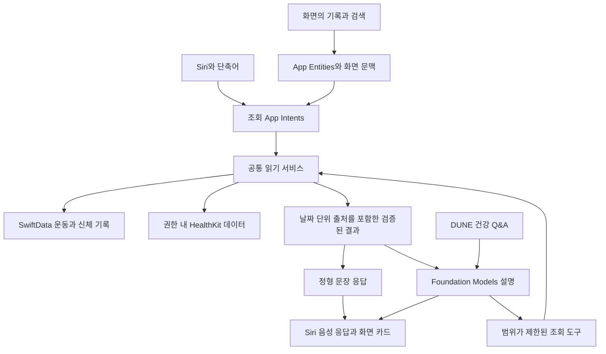

# DUNE 건강 정보 질의를 위한 Siri와 Foundation Models 조사

DUNE에 기록된 운동과 신체 정보를 음성으로 조회하고, 기간별 비교와 설명까지 제공하는 기능을 검토한다. 대상은 Xcode 27.2와 iOS 27.2 계열이다. 권장 구조는 **정확한 조회를 담당하는 공통 서비스에 App Intents와 Foundation Models를 연결하는 방식**이다. 단순 조회에는 생성 모델을 거치지 않고, 복합 질문에는 실제 조회 결과를 근거로 모델이 설명하도록 한다.

## 제품 목표와 범위

사용자는 앱을 열지 않고 최근 운동·체중·수면·컨디션을 듣거나, 화면의 운동 기록을 가리켜 질문하고 싶다. Siri의 자연어 이해, 앱 내부의 데이터 질의, 생성 모델의 설명을 함께 활용한다.

이번 범위는 조사와 설계 제안이다. 아래 기능명·타입명·대화 예시는 구현 후보이며 현재 지원 기능이 아니다. 모든 예시가 Siri의 단일 발화로 자동 연결된다는 의미도 아니다. 현재 지원은 운동 템플릿 열기와 수동 체크형 습관 완료 두 가지다.

## 27.2에서 확인된 사실

| 항목 | 확인 결과 | DUNE에 주는 의미 |
|---|---|---|
| 도구 체인 | Xcode 27.2는 Swift 6.4와 iOS·iPadOS·watchOS·macOS·visionOS 27.2 SDK를 포함한다. | SDK와 대상 기기 OS를 각각 확인해야 한다. |
| 한국어 Siri AI | Apple은 2026-10-26에 27.2 계열에서 한국어 지원을 발표했다. Siri AI는 베타이며 지원 기기·지역 조건이 있다. | 한국어를 주 대상으로 개발할 근거가 생겼다. |
| Siri의 대화 문맥 | iOS 27.2 지원 문서는 이전 대화 회상과 더 넓은 개인 문맥을 설명한다. | 앱이 Siri의 전체 대화 기록을 직접 받는다는 의미는 아니다. |
| 로컬 개발 환경 | `xcodebuild -version` 결과는 Xcode 27.1, build 27A9275였다. | 이 조사의 27.2 판단은 공식 문서 기준이며 27.2 빌드 검증은 별도로 필요하다. |

근거: [Xcode 27.2 Release Notes](https://developer.apple.com/documentation/xcode-release-notes/xcode-27_2-release-notes), [27.2 한국어 Siri AI 발표](https://www.apple.com/newsroom/2026/10/siri-ai-is-available-in-more-languages-starting-today/), [iOS 27 업데이트](https://support.apple.com/en-by/149076).

Foundation Models의 PCC·Dynamic Profiles, App Intents의 장시간 실행·새 테스트 프레임워크 등은 27.0 계열에 도입된 기술이다. 27.2에서 사용할 수 있다는 것과 27.2에 처음 추가됐다는 것은 구분한다. 로컬 27.1 SDK의 공개 Swift interface에서도 PCC, DynamicProfile, LongRunningIntent, AppIntentsTesting, SpotlightSearchTool의 선언과 가용성을 확인했다. 선언 확인은 실행 검증을 대신하지 않는다.

## Apple이 제시하는 연동 방향

Apple은 앱의 데이터와 동작을 구조화해 Siri에 제공하는 접근을 제시한다. `AppEntity`는 실제 데이터 항목, `AppIntent`는 수행할 동작을 표현한다. 시스템이 의미를 아는 `AppSchema`에 맞추고, 검색 가능한 항목을 Spotlight에 등록하며, 화면과 엔터티의 관계를 알려주면 Siri가 문맥을 활용한다. 개발자가 모든 발화의 표현을 직접 나열하는 부담을 줄이는 방향이다. [WWDC26 App Schemas](https://developer.apple.com/videos/play/wwdc2026/240/).

Siri와 Foundation Models의 역할은 다르다. Siri는 시스템 차원의 발화 해석과 요청 연결을 담당한다. Foundation Models는 DUNE이 직접 구성한 세션·도구·지시문으로 답변을 생성하는 API다. Apple Intelligence가 사용하는 모델 기술에 접근할 수 있어도 Siri의 대화 기록, 권한, 시스템 도구 전체가 DUNE 세션으로 공유되지는 않는다. [Apple Intelligence와 Siri AI 연동](https://developer.apple.com/documentation/appintents/apple-intelligence-and-siri-ai), [Foundation Models 업데이트](https://developer.apple.com/videos/play/wwdc2026/241/).

### 건강 정보에 적용할 때의 제약

공개된 App Schema 도메인 목록에는 건강·체성분·운동 이력 질의 전용 도메인이 없다. Notes·Messages 등의 스키마를 건강 기록에 임의로 씌우면 안 된다. Apple은 실제 용도에 맞는 스키마만 적용하도록 명시한다. 이 때문에 사용자 정의 건강 엔터티를 만들었다는 이유만으로 Siri의 자유로운 정보 질의가 모두 지원된다고 보장할 수 없다. [도메인 목록](https://developer.apple.com/documentation/appintents/app-schema-domains), [스키마 적용 기준](https://developer.apple.com/documentation/appintents/making-actions-and-content-discoverable-by-apple-intelligence).

어떤 앱에도 적용할 수 있는 `.system.searchInApp`과 `.system.open`은 사용할 수 있다. 전자는 앱 내 검색 결과로 이동하는 동작이며, 건강 질문에 음성으로 답하는 범용 스키마가 아니다. [System and in-app search](https://developer.apple.com/documentation/appintents/app-schema-domain-system-and-in-app-search).

Apple의 Health 앱 자체 연동과 DUNE의 연동도 구분해야 한다. 2026-09-18 게시된 지원 문서는 Siri AI에서 Health 앱 데이터 읽기가 현재 제공되지 않는다고 명시한다. 이 문서는 27.2의 한국어 지원 발표보다 앞서므로 27.2 실기기에서 다시 확인할 항목으로 남긴다. DUNE이 HealthKit 권한을 받아 자체 intent에서 읽고 응답하는 경로가 금지되거나 불가능하다는 근거는 아니다. [Siri의 Health 앱 접근 지원 문서](https://support.apple.com/en-au/118493).

## 사용할 기술과 우선순위

| 기술 | 적용 목적 | 우선순위와 조건 |
|---|---|---|
| 조회용 AppIntent + AppShortcut | 최근 운동·체중·컨디션처럼 명확한 질문을 음성으로 실행 | 최우선. 등록한 진입점과 파라미터 대화부터 검증 |
| `ProvidesDialog` + `IntentDialog` | 조회 결과를 Siri가 읽을 수 있는 문장으로 반환 | 최우선. 단독으로 이해되는 음성 응답 작성 |
| `ReturnsValue` + AppEntity | 숫자·기간·기록을 후속 단축어에서 재사용 | 최우선. 음성과 구조화된 결과를 함께 제공 |
| `ShowsSnippetView` | 숫자·추세·기록 열기 버튼을 Siri 화면에 표시 | 음성만 사용하는 기기에서도 응답이 완결되어야 함 |
| `AppEntity` + EntityQuery 계열 | 운동·신체 측정·일별 요약을 안정적인 ID로 조회 | 필요한 속성과 필터만 노출 |
| `.system.searchInApp` + OpenIntent | “DUNE에서 지난달 달리기 찾아줘”를 검색·상세 화면에 연결 | 건강 전용 스키마가 없는 상황의 범용 연결점 |
| View annotations + NSUserActivity | “이 운동”, “이 기록” 같은 화면 기반 참조 전달 | 운동 상세·체성분 상세부터 검증 |
| IndexedEntity + Core Spotlight | 자연어로 기록을 찾고 해당 항목으로 이동 | 민감 정보의 노출 범위·보호 수준을 먼저 정함 |
| SpotlightSearchTool | DUNE 모델 세션이 등록된 운동 메모·보고서를 검색 | 앱 내부 검색 기반 답변. Siri 스키마를 추가하는 기능은 아님 |
| Foundation Models Tool + Generable | 질문에 맞는 조회를 실행하고 결과를 설명 | 실제 조회·계산·접근 검사는 일반 코드가 수행 |
| Dynamic Profiles | 운동·체성분·수면 질문에 필요한 도구·지시문·모델만 활성화 | 도구 과다 등록과 문맥 소비를 줄이는 데 사용 |
| ToolCallingMode | 근거를 읽기 전 답변 생성을 제한 | `.required` 사용 시 종료 조건과 호출 한도 필요 |
| PCC | 긴 기간의 다중 지표 분석과 복합 설명 | managed entitlement·적격성·네트워크·사용량 조건 |
| LongRunningIntent + CancellableIntent | 긴 보고서 생성의 진행률·취소 처리 | 즉시 읽기와 장시간 분석의 UX를 분리 |
| SyncableEntity | iPhone에서 언급한 기록을 다른 기기에서 식별 | 실제로 기기 간 안정적인 ID인 경우만 채택 |
| Transferable / ValueRepresentation | 요청한 보고서를 다른 앱에 전달 | 사용자가 공유를 요청한 범위만 전달 |
| Interaction donations | 실제 앱 사용 동작을 시스템의 문맥에 반영 | 도메인 적합성이 있는 동작만, 실제 사용 시점에 적용 |
| AppIntentsTesting + Evaluations | 시스템 경로와 생성 답변의 품질을 각각 검사 | 두 종류의 검증이 모두 필요 |

응답·화면 문맥·donation의 근거: [Advanced App Intents](https://developer.apple.com/videos/play/wwdc2026/343/). 엔터티 속성과 인덱싱의 근거: [Making app entities available in Spotlight](https://developer.apple.com/documentation/appintents/making-app-entities-available-in-spotlight). 긴 실행·기기 간 ID·구조화된 전달의 근거: [App Intents 새 기능](https://developer.apple.com/videos/play/wwdc2026/345/).

`RelevantEntities`도 존재하지만 문서의 workout 예시는 운동 상황에 적합한 **음악**을 추천하는 기능이다. 이를 DUNE의 건강 요약을 어떤 상황에서든 추천하는 API로 확대 해석하지 않는다. `EntityCollection`은 대량 엔터티를 ID 중심으로 처리할 때 유용하며, 짧은 음성 질의에 필수는 아니다.

## 기능 후보와 데이터 요구사항

아래 예시는 원하는 사용자 경험이다. 실제 진입 문구·추가 질문 필요 여부는 한국어 Siri에서 검증한다.

| 기능 | 질문 예시 | 필요한 데이터와 계산 |
|---|---|---|
| 최근 운동 | “DUNE에서 마지막 운동 알려줘” | 날짜, 종목, 시간, 완료 상태 |
| 기간별 운동 요약 | “이번 주 운동 얼마나 했어?” | 달력 주간 범위, 중복 제거, 횟수·시간·거리·열량 |
| 근력운동 세부 기록 | “지난번 벤치프레스 몇 킬로로 했지?” | 앱의 운동 ID, 완료된 세트, 실제 중량·횟수, 워밍업 구분 |
| 개인 기록 | “스쿼트 최고 기록 알려줘” | 최고 중량·추정 1RM·볼륨 중 무엇인지 정의 또는 확인 |
| 유산소 상세 | “마지막 달리기 거리랑 페이스는?” | 거리·활동 시간·평균 페이스·평균 심박, 측정값 존재 여부 |
| 신체 최신값 | “최근 체중과 체지방률 알려줘” | 항목별 최신값·측정일·단위·출처 |
| 신체 추세 | “지난달보다 체중이 얼마나 바뀌었어?” | 비교 기준일 또는 기간 평균, 표본 수, 희소 측정 처리 |
| 수면 | “어젯밤 얼마나 잤어?” | 수면 귀속일·총수면·단계·각성 시간 |
| 컨디션과 회복 | “오늘 컨디션이 평소보다 어때?” | DUNE 점수와 HRV·RHR·수면의 실제 기준선 |
| 비교 설명 | “최근 운동량이 늘면서 수면은 어땠어?” | 두 기간의 집계와 데이터 충족도. 인과관계로 단정하지 않음 |
| 화면 참조 | “이 운동 지난번이랑 비교해줘” | 현재 운동 엔터티, 비교 기록의 해석, 앱 내 비교 서비스 |
| 메모 검색 | “무릎이 불편하다고 적었던 운동 찾아줘” | 메모의 의미 검색과 원본 기록 식별 |
| 보고서 전달 | “이번 주 운동 요약을 공유할 수 있게 만들어줘” | 사용자 요청 범위의 텍스트·파일 생성, 별도의 공유 동작 |

기존 건강 앱에 없는 DUNE의 차별점은 근력운동 세트, 기록 비교, 자체 컨디션 점수와 운동 메모를 함께 다루는 데 있다. 단순 체중 조회를 넘어 앱이 이미 가진 의미를 전달하는 데 우선순위를 둔다.

## 권장 구조

공통 읽기 서비스가 기간 해석·출처 병합·단위 변환·집계를 맡는다. App Intent와 AI Tool은 같은 결과를 사용한다. 이름 후보는 `HealthInformationQuerying`, `HealthQueryRequest`, `HealthQueryResult`이며 확정된 API가 아니다.

결과에는 값 외에 요청 범위, 측정 시각, 조회 시각, 단위, 원본 ID, 출처, 데이터 충족 상태를 포함한다. 모델이 숫자나 기간을 바꿔 말했는지 검사할 수 있어야 한다. `@Generable`은 출력 형식을 제한하지만 내용의 사실성까지 보장하지 않는다.

단순 조회는 이 결과를 템플릿 문장으로 바로 반환한다. “최근 체중은 …이며 …에 측정했습니다”처럼 값과 날짜를 함께 읽는다. 복합 설명은 검증된 요약을 모델에 전달한다. 최종 문장에서 새로운 측정값을 만들어내지 못하도록 수치·단위·인용 ID를 검증하고, 실패하면 정형 응답으로 내려간다.

### Siri 진입 경로

소수의 대표 App Shortcuts를 제공하고, intent는 기능별로 나눈다. 후보는 최근 운동 조회, 운동 요약 조회, 신체 지표 조회, 오늘 컨디션 조회, DUNE에 건강 질문하기다. Apple 샘플은 대표 동작 2~5개, 최대 10개를 안내하므로 내부 조회 기능 수와 노출되는 대표 shortcut 수를 같게 만들 필요는 없다. [App Intents 샘플](https://developer.apple.com/documentation/appintents/acceleratingappinteractionswithappintents/).

자유 질문용 `AskDUNEHealthIntent(question: String)`는 질문을 받아 DUNE QA로 전달하는 후보다. 질문이 없으면 파라미터 대화로 요청한다. 임의의 긴 질문이 AppShortcut 발화에서 한 번에 정확히 추출되는지, 후속 질문이 이전 intent의 문맥과 연결되는지는 검증 전 보장하지 않는다. typed 조회와 일반 질문 진입점을 함께 제공해 실패 경로를 줄인다.

Siri가 읽는 답변은 `IntentDialog`로 반환한다. 앱의 별도 TTS를 동시에 재생하지 않는다. 실제 낭독 여부는 Siri의 기기와 응답 설정도 영향을 주므로 iPhone·AirPods·Watch에서 직접 확인한다. 짧은 화면용 문구와 음성만으로 이해 가능한 전체 문구를 구분할 수 있다. [Siri 응답 구성](https://developer.apple.com/videos/play/wwdc2026/343/).

## Foundation Models 활용

### Tool calling과 검증

질문별 도구 후보는 운동 목록, 운동 세트, 신체 지표, 수면 요약, 회복 요약, 기간 비교다. 읽기 기능에 쓰기 도구를 섞지 않는다. 기간 상한·최대 반환 건수·동시 실행·실행 취소는 도구 구현에서 제어한다. 모델에게 SQL이나 임의 HealthKit predicate를 직접 생성·실행시키지 않는다.

새 `GenerationOptions.ToolCallingMode`의 `.required`를 사용하면 답변 전에 도구 호출을 요구할 수 있다. 하지만 올바른 도구·필터·기간을 선택했다는 보장은 아니므로 결과를 별도로 검사한다. `.required`는 종료 조건 없이 두면 반복 호출을 만들 수 있어, 필요한 근거 확보 후 `.allowed` 또는 `.disallowed`로 전환한다. [Tool calling 공식 문서](https://developer.apple.com/documentation/foundationmodels/expanding-generation-with-tool-calling).

### Dynamic Profiles와 대화 관리

운동 질문에는 운동 조회 도구를, 체성분 질문에는 신체 조회 도구를 활성화한다. `DynamicInstructions`, `LanguageModelSession.Profile`, `DynamicProfile`, `@SessionProperty`를 사용해 도구·지시문·모델 구성을 조정할 수 있다. `.historyTransform`은 요청에 필요한 대화만 모델에 전달하고 민감한 과거 내용을 제거하는 데 사용할 수 있다. [Dynamic Profiles 공식 문서](https://developer.apple.com/documentation/foundationmodels/composing-dynamic-sessions-with-instructions-and-profiles).

앱 내 대화는 선택한 기간·운동 ID 같은 구조화된 문맥을 보존한다. Siri가 다시 호출한 경우에는 실제 전달된 파라미터·엔터티를 우선하며, 앱의 마지막 채팅을 모든 Siri 질문에 무조건 붙이지 않는다. 장기간 유지된 세션의 baseline과 도구 결과는 새 조회 시점에 갱신한다. 도구 호출·문맥 사용량·지연 시간을 계측한다. [Agentic app experiences](https://developer.apple.com/videos/play/wwdc2026/242/).

### 온디바이스와 PCC

| 방식 | 장점 | 조건 | DUNE 권장 용도 |
|---|---|---|---|
| 정형 코드 응답 | AI 가용성과 관계없이 수치·날짜를 정확히 표현 | 원본 데이터 접근 필요 | 최신값·단일 운동·기간 합계 |
| SystemLanguageModel | 온디바이스 처리, 오프라인 생성 | 지원 기기·모델 준비·언어 확인 | 짧은 비교와 설명 |
| PrivateCloudComputeLanguageModel | 더 큰 문맥과 reasoning | 적격 개발자·entitlement·네트워크·일일 한도 | 장기 추세·여러 지표의 종합 설명 |

Apple 문서는 온디바이스 4K, PCC 32K 문맥을 설명한다. 실제 구성은 `contextSize`와 토큰 수 API로 판단하고 고정 숫자에만 의존하지 않는다. PCC에는 reasoning 단계와 quota 상태 API가 있다. Watch의 Foundation Models 활용은 PCC 경로와 온디바이스 경로의 플랫폼 가용성을 구분해야 한다. `SpotlightSearchTool`은 로컬 SDK 기준 watchOS에서 사용할 수 없다. [PCC 모델 사용](https://developer.apple.com/documentation/foundationmodels/adding-server-side-intelligence-with-private-cloud-compute), [PCC 세션](https://developer.apple.com/videos/play/wwdc2026/319/).

PCC 무상 접근 조건은 App Store Small Business Program 가입, 각 앱의 최초 다운로드 수 기준 충족, 계정에 부여된 managed entitlement다. DUNE의 적격성이나 entitlement 보유 여부는 이 조사에서 확인하지 않았다. 이를 기본 필수 의존성으로 두지 않는다. [PCC 접근 조건](https://developer.apple.com/private-cloud-compute/).

PCC로 전환할 때는 필요한 요약과 최소 문맥만 전송한다. 오프라인·한도 소진·미지원 시 온디바이스 또는 정형 조회로 돌아간다. Foundation Models는 외부 모델 provider도 지원하지만 건강 데이터를 보내는 범위와 정책이 달라지므로 DUNE의 기본 경로에 외부 provider를 자동 추가하지 않는다. [Foundation Models 업데이트](https://developer.apple.com/videos/play/wwdc2026/241/).

### 이미지와 음성 입력의 범위

27 계열은 이미지 입력과 Vision 기반 `OCRTool`, `BarcodeReaderTool`도 제공한다. DUNE의 다음 확장으로는 체성분 측정표 사진에서 수치·단위·날짜를 추출하고 사용자가 확인한 뒤 기록하는 흐름이 가능하다. 이미 저장된 운동·신체 정보 질문은 원본의 구조화된 값을 직접 읽는 것이 적합하다. 사진만 보고 체지방률이나 의학적 상태를 추정하는 기능과 측정표의 글자를 읽는 기능은 구분한다. [멀티모달 프롬프트](https://developer.apple.com/documentation/foundationmodels/analyzing-images-with-multimodal-prompting).

Foundation Models의 텍스트·이미지 모델 API를 Siri의 음성 인식·낭독 API와 동일시하지 않는다. 이번 범위의 시스템 음성 입출력은 Siri가 담당한다. DUNE 내부에 별도 음성 대화 화면을 만들 경우에는 음성 인식과 음성 합성을 별도로 설계한다. 이미지 입력과 외부 모델 도입은 기록 읽기 기능의 필수 조건이 아니다.

### Spotlight 기반 검색

운동 메모나 긴 보고서에는 `SpotlightSearchTool`이 유용하다. 모델이 앱의 인덱스에서 관련 항목을 찾고 답변 근거로 사용한다. 원문을 필요할 때 다시 제공하는 delegate, 검색 가능 속성을 제한하는 guidance profile, 계산을 담당하는 pipeline stage를 지원한다. DUNE의 정밀 집계는 먼저 공통 조회 서비스에 두고, 의미 검색은 메모·보고서 탐색에 사용한다. [Spotlight LLM 검색](https://developer.apple.com/videos/play/wwdc2026/246/), [Apple 샘플](https://developer.apple.com/documentation/corespotlight/searching-indexed-content-with-natural-language).

인덱싱된 항목은 생성·수정·삭제와 함께 갱신한다. 보호된 사용자 지정 인덱스를 사용하고, 원본이 삭제되거나 접근 설정이 달라지면 관련 인덱스도 정리한다. 기본 인덱스에 체중·건강 메모 전체를 자동 등록하는 설계는 피한다. 공개 인덱싱이나 Spotlight 등록은 건강 정보 음성 조회의 전제 조건이 아니다. [인덱스 보호](https://developer.apple.com/documentation/corespotlight/cssearchableindex), [인덱스 추가 지침](https://developer.apple.com/documentation/corespotlight/adding-your-app-s-content-to-spotlight-indexes).

### 장시간 실행

일반 intent 실행의 30초 제한을 넘는 작업에는 `LongRunningIntent`와 `performBackgroundTask`가 제공된다. 진행률 보고가 필요하며 Live Activity를 통해 진행과 취소를 제공할 수 있다. `CancellableIntent`는 취소 시 정리를 돕는다. background GPU 사용에는 별도 지원·entitlement 조건이 있다. 이 기능이 Siri의 즉시 답변을 무기한 기다리게 하는 보장은 아니다. 단순 질의는 빠르게 끝내고 긴 분석은 진행 상황을 볼 수 있는 별도 보고서 흐름으로 설계한다. [장시간 intent 실행](https://developer.apple.com/videos/play/wwdc2026/345/).

## 현재 DUNE 코드의 재사용 범위

| 코드 | 이미 있는 기능 | 확장할 부분 |
|---|---|---|
| `DUNE/App/Intents/DUNEShortcuts.swift:56` | 템플릿 열기, 습관 완료, 대표 발화 | 정보 조회 intent, 구조화된 결과와 음성 응답 |
| `DUNE/Domain/Protocols/HealthDataQuestionAnswering.swift:10` | UI와 독립된 Sendable QA 계약 | Siri 어댑터에서 재사용 |
| `DUNE/Data/Services/HealthDataQAService.swift:4` | actor, 주입된 서비스, 언어·가용성 처리 | 신체·세트·명시적 기간 질의와 결과 검증 |
| `DUNE/Data/Services/HealthDataQAService.swift:140` | 컨디션·수면·운동·회복 4개 도구 | 질문별 도구 구성과 필요 근거 확보 검사 |
| `DUNE/Data/Services/HealthDataQAService.swift:331` | 운동 횟수·시간·최근 운동·종목·열량 요약 | 개별 운동, 거리·페이스·심박·세트, 장기간 비교 |
| `DUNE/Data/HealthKit/BodyCompositionQueryService.swift:19` | 체중·체지방률·제지방량·BMI 질의 | QA 연결, 앱 내 수동 기록과의 정책 일치 |
| `DUNE/Domain/Models/SharedHealthSnapshot.swift:75` | 체중·BMI, 출처별 실패 상태, 조회 시각 | QA 출력에 신체 정보와 구체적 가용성 반영 |
| `DUNE/Data/Persistence/Models/ExerciseRecord.swift:5` | 운동 ID, 거리·페이스, HealthKit 연결 ID | 읽기 전용 snapshot 및 필터 지원 |
| `DUNE/Data/Persistence/Models/WorkoutSet.swift:5` | 실제 중량·횟수, 계획 횟수, 완료 여부 | 세트 기반 질문의 집계와 구분 |
| `DUNE/Data/Persistence/Models/BodyCompositionRecord.swift:5` | 수동 신체 기록 | HealthKit과 일관된 병합·출처 정책 |
| `DUNETests/AIFeatureEvaluationDataset.swift:36` | 3개 언어의 합성 QA 9개 사례 | 신체·세트·기간·실패·대화 문맥 사례 |

현재 QA는 운동 30일, 일부 컨디션·수면·회복 요약 14일 등으로 제한된다. 기존 서비스를 그대로 Siri에 연결하면 “올해 운동”이나 세트 단위 질문에 충분한 근거를 제공할 수 없다. 모델의 언어 능력보다 먼저 조회 범위를 확장해야 한다.

`DUNEAppIntentStore`는 현재 템플릿·습관용 SwiftData 접근을 맡는다. 모든 HealthKit·AI 질의를 이 저장소에 추가하기보다는 별도 읽기 서비스와 런타임 의존성 주입을 둔다. cold launch에서도 읽기 서비스가 준비되는지 확인한다.

관련 과거 문서: [기존 App Intents 계획](../plans/2026-10-14-ios27-app-intents.md), [iOS 27 통합 도입 계획](../plans/2026-10-14-ios27-stacked-adoption.md), [기존 intent 저장·라우팅 해결책](../solutions/architecture/2026-10-14-ios27-app-intents-swiftdata-routing.md). 과거 계획의 민감 건강값 기본 제외는 당시 템플릿·습관 범위의 결정이었다. 사용자가 명시적으로 요청한 건강 읽기 확장은 별도 접근 정책을 설계해 진행할 수 있다.

## 정확성에 필요한 계약

1. **기간:** 오늘·어젯밤·이번 주·지난달·최근 7일의 의미를 달력·시간대 기준으로 정한다. rolling window를 달력 주간으로 바꿔 말하지 않는다.
2. **최신값:** 항목마다 측정 날짜를 유지한다. 최근 체지방률이 오래된 값이면 체중과 같은 날 측정한 것처럼 답하지 않는다. 기존 `fetchLatestWeight(withinDays:)`는 오늘을 제외하는 fallback 용도이므로 단독 최신값 API처럼 재사용하지 않는다.
3. **데이터 없음과 접근 문제:** HealthKit은 읽기 거부를 앱에 직접 알리지 않으므로 빈 결과만 보고 “권한이 거부됐다” 또는 “기록이 없다”고 단정하지 않는다. 알려진 오류와 접근 가능한 데이터가 없음을 구분한다.
4. **잠긴 기기:** HealthKit 보호 데이터는 잠금 상태에서 읽을 수 없을 수 있다. stale cache를 최신값처럼 낭독하지 않고 필요하면 잠금 해제를 안내한다.
5. **중복:** 앱 기록·HealthKit·Watch 동기화 경로를 합칠 때 연결 ID를 우선 사용한다. 단순 종목·날짜 근접성만으로 서로 다른 운동을 삭제하지 않는다.
6. **세트:** 완료된 실제 세트와 계획·워밍업·실패 세트를 구분한다. 최고 중량과 추정 1RM은 다른 답이다.
7. **단위:** kg/lb, km/mi, 페이스 단위를 설정과 맞춘다. HealthKit 체지방 원시 비율과 앱의 % 값을 혼동하지 않는다. 제지방량을 골격근량이라고 부르지 않는다.
8. **설명:** 실제 값·앱 계산 점수·AI 설명을 구분한다. 운동량과 수면이 함께 변했다고 원인으로 단정하지 않는다.
9. **문맥과 동시 실행:** Siri 호출과 앱 QA가 같은 mutable session을 동시에 사용하지 않게 한다. 이전 질문·기기·날짜의 문맥이 잘못 섞이지 않아야 한다.
10. **민감 출력:** 사용자 설정에 따라 잠금 화면·Siri 카드·음성·인덱스·공유의 노출 범위를 다룬다. 기기 인증이 끝나기 전에 민감한 EntityQuery 결과가 반환되는 경로도 검토한다.

HealthKit의 읽기 권한 비공개와 잠금 상태 제약은 [Protecting user privacy](https://developer.apple.com/documentation/healthkit/protecting-user-privacy)에 명시되어 있다. Foundation Models의 guardrail 실패와 거절은 별도 상태로 처리하며 우회하지 않는다. 기록 조회·추세 설명과 질병 진단·치료 결정은 기능 범위를 구분한다. [모델 출력 안전성](https://developer.apple.com/documentation/foundationmodels/improving-the-safety-of-generative-model-output), [Foundation Models 사용 요건](https://developer.apple.com/support/terms/acceptable-use-requirements-for-the-foundation-models-framework/).

현재 QA의 수면 fallback은 일부 query 오류를 빈 배열로 바꾸며, baseline은 실패한 출처를 개수로만 표현한다. 이 상태를 그대로 음성 응답에 사용하면 “확인할 수 없음”이 “수면 기록 없음”으로 들릴 수 있다. 또한 현재 QA의 AI 미지원 fallback은 안내 문구이므로, AI 없이도 가능한 정형 조회 fallback은 새로 제공해야 한다.

## 검증 방법과 출시 기준 후보

`AppIntentsTesting`은 앱과 별도 프로세스에서 실제 intent 스택을 실행하고 엔터티 질의·결과·Spotlight·화면 annotation을 검사한다. XCUITest bundle을 사용하지만 화면 조작에 의존하지 않는 통합 테스트를 작성할 수 있다. intent를 Swift 함수처럼 직접 호출하는 테스트와 구분한다. 자연어 인식과 실제 낭독은 한국어 Siri 수동 검증도 필요하다. [AppIntentsTesting 세션](https://developer.apple.com/videos/play/wwdc2026/295/).

`Evaluations`는 입력 사례·정답·도구 호출 경로·지표를 모아 생성 기능의 품질을 측정한다. 수치와 날짜는 결정적 검사로 채점하고, 자연스러운 설명과 근거 밖 단정은 정성 평가로 보완한다. 모델 judge만으로 숫자 정확도를 판정하지 않는다. [Evaluations 세션](https://developer.apple.com/videos/play/wwdc2026/298/).

| 검증 범위 | 필수 사례 |
|---|---|
| 데이터 질의 | 월·주 경계, 시간대, sparse body measurements, 오늘 측정 포함, 삭제·중복·미완료 세트 |
| intent 경로 | cold launch, 파라미터 누락, 삭제된 ID, 인증 필요, 취소·동시 실행 |
| 모델 | 한국어 변형 질문, 도구 미호출, 잘못된 도구·기간, 미지원 질문, 오래된 baseline |
| 가용성 | AI 비활성·미지원 언어, 모델 미준비, 오프라인, PCC 한도 소진 |
| 프라이버시 | 잠금 상태, 민감 인덱스 보호, 설정 해제·삭제 후 인덱스와 cache 정리 |
| 실제 음성 | 한국어 Siri, iPhone·AirPods·Watch, 첫 질문과 후속 질문, 숫자·단위·날짜 낭독 |
| 긴 분석 | 진행률, 취소, deadline, background 자원 접근, 정형 응답 fallback |

출시 기준은 시제품을 측정한 뒤 정한다. 단순 수치 질의의 계산 정확도, 실제 필터 일치, 원본 참조, 근거 없는 수치 생성 여부를 먼저 검사한다. 모델과 OS 업데이트 후 같은 데이터셋으로 회귀를 확인한다.

## 구현 순서 제안

1. **정확한 읽기 기반:** 기간·단위·출처·가용성 계약과 공통 질의 서비스를 만든다. 최근 운동·체중·운동 합계를 정형 문장으로 반환한다.
2. **Siri 정보 조회:** 대표 App Shortcuts, 음성 응답, 구조화된 반환값, 간단한 snippet을 추가한다. 한국어 실기기로 진입 경로를 확인한다.
3. **기존 QA 확장:** 신체 지표·세트 상세·명시적 기간 비교를 추가하고 조회 도구와 App Intent가 같은 결과를 사용하도록 한다.
4. **자연어와 화면 문맥:** Dynamic Profiles, 근거 조회 요구, 자유 질문 진입점, `.system.searchInApp`, 운동 상세 annotation을 추가한다. 자유 발화 지원 범위를 실제 결과로 결정한다.
5. **기록 탐색과 장기 분석:** 보호된 Spotlight 인덱스·SpotlightSearchTool, PCC 적격성 확인, 긴 분석의 진행·취소를 추가한다.
6. **다른 기기와 공유:** 안정 ID 기반 SyncableEntity, Watch 실행 경로, 사용자 요청에 따른 보고서 전달을 확장한다.

별도 확장 후보로 `StartWorkoutIntent`, `PauseWorkoutIntent`, `ResumeWorkoutIntent`가 있다. 로컬 SDK에서 존재를 확인했지만 기록 읽기와 다른 동작이므로 현재 조사 범위의 선행 조건은 아니다. 운동 시작·중지·종료를 건강 정보 읽기와 구분해 설계한다.

이 조사의 미검증 항목은 Xcode 27.2 실빌드, 한국어 Siri의 개별 발화 라우팅, 실제 낭독과 후속 문맥, PCC entitlement·적격성, 잠금 기기와 Watch에서의 접근·실행이다. 앱 코드는 변경하지 않았으며 실제 사용자 건강 데이터도 조회하지 않았다.

후속 디자인으로 [SQ01–SQ14 배치·상태 계약](../design/layout-map/siri-health-queries-proposal.md)과 [기능별 비주얼 시안](../design/theme-map/themes/dune-siri-health-queries.html)을 추가했다. V1/V2·밝음/어두움·기기 폭·큰 글씨·데이터 상태를 비교할 수 있으며 테마맵과 레이아웃맵에서 연결한다. 합성 데이터의 HTML 제안이고 앱 구현·실제 Siri 화면이 아니다.

## /run 후속: 자연스러운 시스템 낭독

건강 조회는 `ProvidesDialog`를 반환하여 시스템 Siri가 읽는다. 앱에서 AVSpeechSynthesizer로 Siri 음색을 복제하지 않는다. [Apple 음성 안내](https://developer.apple.com/videos/play/wwdc2020/10022/)에서 이 두 음성 경로를 구분한다. 최신 SDK의 [IntentSystemContext.locale](https://developer.apple.com/documentation/appintents/intentsystemcontext/locale)은 요청 언어가 앱 언어와 다른 경우를 처리한다. 이 값을 요청별 TaskLocal로 전달하여 단위·숫자·날짜와 조회 안내를 같은 언어로 만든다. 전체 답변과 supporting 답변 모두 검증한 값을 포함해 화면이 있는 호출에서도 제목만 읽지 않게 한다. 한국어 자연 단위·언어 격리 테스트와 실기기 음색·억양 청취는 별개이며, 후자는 아직 검증하지 않았다.

현재 로컬은 Xcode 27.1 / SDK 27.1이다. 공개 27 API를 이 환경에서 컴파일하고 27.2 기술 방향과의 호환성을 설계했으며, Xcode 27.2로 직접 빌드했다고 표시하지 않는다. PCC는 실제 managed entitlement가 검증되지 않아 비활성이고, SpotlightSearchTool은 보호된 사용자 지정 인덱스로 검색 범위를 격리하는 계약을 확인하지 못해 연결하지 않았다. 정확한 운동 메모 검색은 공통 조회 서비스에서 제공한다.

[Apple의 Siri 음성·언어 설정 안내](https://support.apple.com/ko-kr/120499)를 2026-10-30 다시 확인했다. 기기의 Siri 음성 선택과 앱이 만드는 읽기 문장은 별도 제어 범위다. 앱은 시스템 음색을 강제하거나 청취하지 않은 음질을 보증하지 않는다. 이번 구현·빌드·언어 테스트와 남은 실기기 청취 범위는 [검증 기록](../reviews/2026-10-30-siri-health-queries/README.md)에 보존한다.

## 실제 Xcode 27.2 업데이트 후 확인 · 2026-10-30 20시

후속 설치 환경은 Xcode 27.2 (27B52)·Swift 6.4.2·SDK 27.2다. 앱19754ce6의 실제 빌드와 관련63개 단위·9개 suite가 통과했다. 현재 사용하는 Siri·Foundation Models API에 필수 교체는 발견되지 않았고, 공개 건강 읽기 스키마나 Siri 전용 음색 선택 API도 확인되지 않았다. 이전 조사 시점의27.1/27.2미검증 문구는 당시 기록이다. [실제 SDK 선언·릴리스 노트·검증 결과](../reviews/2026-10-30-siri-health-queries/sdk-27-2-audit.md)를 최신 판단으로 따른다.
